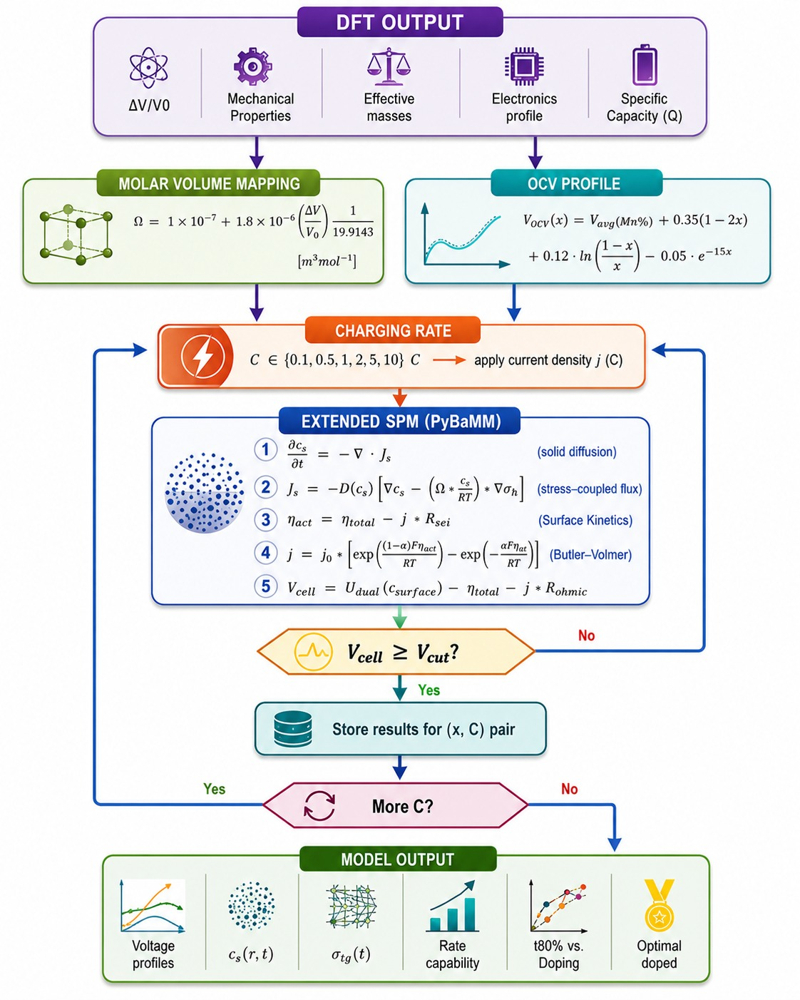

# Isovolumetric Design of Layered Oxide Cathodes for High Rate Sodium Ion Batteries: A Multi-Scale Predictive Approach 

This repository provides open-source implementations comparing the standard Single Particle Model (SPM) against a Modified Single Particle Model (MSPM) coupled with DFT-derived mechanical parameters and stress-induced diffusion.

## Methodology Flowchart



## Model Formulations
### 1. Standard Single Particle Model (SPM)
- Assumes isolated spherical cathode and anode particles.
- Solid-state diffusion governed by standard Fickian kinetics:
  $$\frac{\partial c_s}{\partial t} = \frac{D_s}{r^2} \frac{\partial}{\partial r} \left( r^2 \frac{\partial c_s}{\partial r} \right)$$
- Interfacial reaction rates dictated by Butler-Volmer kinetics.
- Assumes rigid particles without volume expansion or concentration-driven mechanical stresses.

### 2. Modified Single Particle Model (MSPM)
- Integrates mechanical deformation, volumetric swelling, and stress-induced solid diffusion.
- Diffusion flux accounts for the gradient of hydrostatic stress $\sigma_h$:
  $$J = -D_s \left( \nabla c_s - \frac{\Omega c_s}{R T} \nabla \sigma_h \right)$$
  where $\Omega$ is the partial molar volume derived from DFT lattice volume variations.
- Solid-state mechanical stress tensor computed dynamically using DFT-calculated Young's modulus $E$ and Poisson's ratio $\nu$.
- Open-circuit potential (OCP) calibrated against DFT formation energies and cell voltages across variable Mn dopant stoichiometry.

## Parameters

The composition-dependent inputs bundled in `Models/spm.py` and `Models/mspm.py` — average voltages from DFT cell-voltage calculations, VRH-averaged elastic constants, and partial molar volumes from DFT volume changes — are provided so the models run out of the box. The diffusivity and volume-fraction values are representative placeholders, **not** the publication-calibrated set: results obtained with the bundled values do not correspond to the paper. The calibrated parameter set will be released alongside the publication.


## Requirements
- Python ≥ 3.10
- [PyBaMM](https://www.pybamm.org)

## Quick Start

Run the comparative benchmark simulating a 1C constant-current charge up to a 4.2 V cutoff:

```bash
python Examples/run_comparison.py
```

### Example Output
```text
Running comparative simulation for Mn 50% (x = 0.5)...

1. Solving Standard Single Particle Model (Model A: SPM)...
   SPM completed in 11.60 min (Final Voltage: 4.200 V)

2. Solving Modified Single Particle Model (Model B: MSPM with stress)...
   MSPM completed in 11.84 min (Final Voltage: 4.200 V)
   Peak Surface Tangential Stress: 28.91 MPa

--- Summary Comparison ---
Composition: Mn 50%
SPM Charge Time:  11.60 min, Final Voltage: 4.200 V
MSPM Charge Time: 11.84 min, Final Voltage: 4.200 V
MSPM Peak Surface Tangential Stress: 28.91 MPa
Simulation finished successfully.
```

## Citation
If you use these models in your research, please cite our corresponding paper. The manuscript has been accepted for publication; the full citation and DOI will be added here once available.

<!-- bibtex template — fill in upon publication
@article{spm_mspm_2026,
  title={First-Principles Informed Continuum Modeling of Stress-Diffusion Coupling in Battery Electrodes},
  author={...},
  journal={...},
  year={2026},
  doi={...}
}
-->
